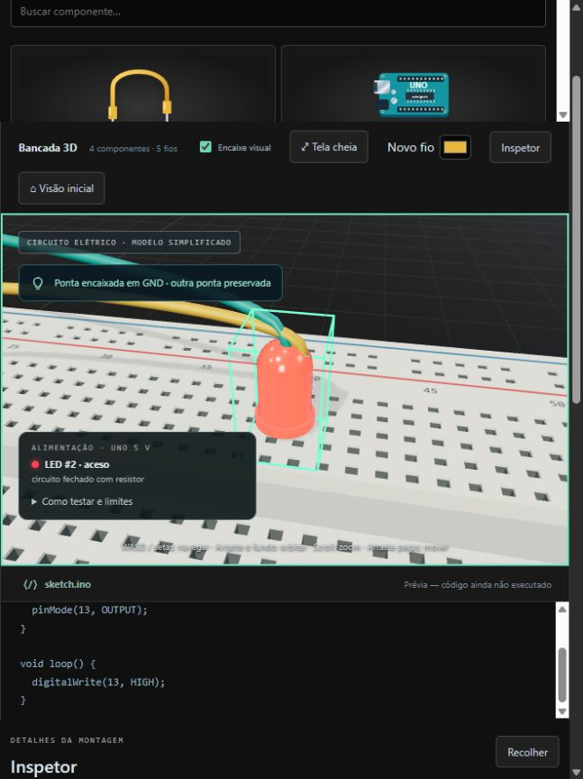
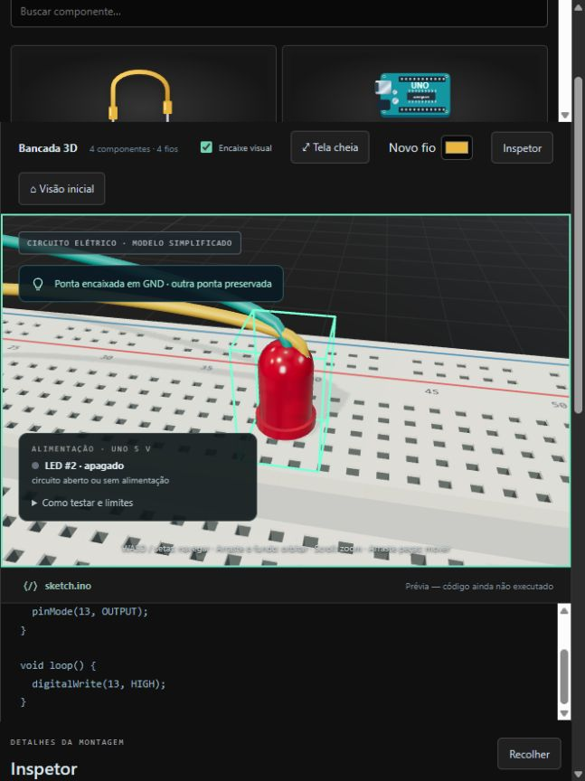

# Modelo elétrico inicial — issue #3

Documento histórico do recorte inicial. A extensão das issues #9–#11 adiciona GPIO/PWM e firmware real; veja [FIRMWARE.md](FIRMWARE.md). O exemplo atual usa D9 no lugar de 5 V.

O exemplo abre com 5 V do Uno → barramento positivo → resistor → LED → barramento negativo → GND. O painel e a emissão de luz do LED usam o resultado de `simulateCircuit`, sem executar o texto do editor.

## Contrato da simulação

`simulateCircuit({ components, wires })` recebe componentes com `id`, `type` e, para protoboards, `columns`. Cada fio contém `id` e duas pontas com `componentId`, `pin` e `occurrence`. Ponta livre usa `componentId: null` e `pin: null`. A saída contém `leds` com `id`, `on` e `reason`, além do estado `supported` das fontes.

Posições, rotações, cores e animações não participam dessa decisão. `visualWires.connections()` fornece somente as referências dos terminais. A bancada compara a topologia a cada quadro e só recalcula quando essas referências, componentes ou a quantidade de colunas mudam. A retirada de uma ponta já abre o circuito durante o gesto; Escape restaura a ligação e o estado anterior.

## Contatos e componentes

| Elemento | Regra neste modelo |
| --- | --- |
| Jumper | Une dois terminais existentes; ponta livre não conduz. |
| Protoboard a–e | Cinco contatos conectados na mesma coluna. Colunas diferentes são isoladas. |
| Protoboard f–j | Outro grupo de cinco na mesma coluna, isolado de a–e. |
| Barramentos | Superior +, Superior −, Inferior + e Inferior − são quatro grupos independentes e contínuos, sem corte central. O sinal impresso não fornece alimentação por si só. |
| Protoboards distintas | Contatos com o mesmo nome permanecem isolados entre peças. |
| Redimensionamento | Usa os contatos da geometria atual. Furos removidos deixam de participar; o mecanismo existente solta suas pontas. Cancelar restaura ambos. |
| Uno | Fonte virtual fixa de 5 V com retorno GND. Os três contatos físicos GND pertencem ao mesmo terra elétrico; as referências físicas continuam separadas nos jumpers. |
| Resistor | Caminho resistivo bidirecional entre 1 e 2. Não calcula resistência, corrente, tensão ou potência. |
| LED | Acende quando ânodo chega a 5 V e cátodo a GND da mesma fonte, com pelo menos um resistor necessário no caminho de ida ou retorno. Polaridade invertida fica apagada. |
| Outros componentes e GPIO | Sem comportamento ativo neste recorte. O editor e os pinos digitais não produzem sinais. |

O encaixe visual das peças na protoboard continua sendo apenas posicionamento. Ele não cria contatos elétricos implícitos. Conecte os terminais de LED e resistor por fios, como na montagem inicial. Mover uma peça ou a protoboard preserva essas referências.

## Limites declarados

É um modelo digital de conectividade, não um simulador analógico. Caminhos são percorridos pelos jumpers, grupos internos e resistores; LEDs são saídas observadas, sem propagação de corrente para outro LED em série. Vários LEDs em ramos independentes são avaliados separadamente.

Um resistor só conta se estiver no caminho: adicionar um resistor solto ou em um desvio não torna uma ligação direta suportada. Qualquer resistor é tratado da mesma forma; isso não garante uma montagem física segura.

Ligação direta ao LED sem resistor, caminho passivo entre 5 V e GND (inclusive derivação resistiva) e fontes interligadas ficam fora do recorte e mantêm os LEDs afetados apagados. Não há cálculo de curto, proteção da fonte, aquecimento, dano virtual ou falha retida. Corrigir as ligações restaura imediatamente a avaliação. Esses estados não antecipam a implementação das tarefas de falha e dano.

`reason` distingue `closed` (aceso), `open` (sem caminho completo suportado), `reversed` (invertido), `unlimited` (ligação direta sem resistor) e `unsupported` (rede fora do recorte). Um circuito não suportado pode ter caminhos físicos que este modelo não representa, como LEDs em série. Firmware, outras tensões e valores dos resistores ficam para etapas seguintes.

## Verificação reproduzível

1. Execute `npm test` e `npm run build`.
2. Abra a bancada. O painel mostra o LED aceso; use a lista para selecionar o LED e “Focar peça” para ver a emissão de luz.
3. Foque o fio #5, retorno ao GND, pela lista de fios. Arraste a ponta no Uno para fora do contato: o painel e o LED ficam apagados. Encaixe novamente em GND: ambos acendem. Escape durante a retirada restaura a ligação.
4. Selecione o LED, altere X ou Z e confirme a edição saindo do campo. A luz permanece acesa e os fios acompanham a peça.
5. Remova o fio #5: a luz apaga. Recarregar a página recria o exemplo, pois persistência ainda não faz parte desta entrega.

Em 05/11/2026, o navegador confirmou retirada, reconexão em GND, movimento do LED de X≈1,28 para X≈2,53 sem apagar, remoção do retorno e leitura em tela cheia. Não houve erros no console durante a verificação. As imagens mostram o mesmo LED após movê-lo, com o retorno conectado e depois removido:

| Circuito fechado | Retorno removido |
| --- | --- |
|  |  |

Os testes em `tests/electrical-simulation.test.js` verificam o circuito fechado/aberto, agrupamentos e isolamento, redimensionamento, polaridade, resistor no retorno, ausência de limitação, fontes e GPIO inativo. `tests/electrical-workbench.test.js` integra os jumpers reais, a simulação, o material do LED e o painel DOM, incluindo cancelamento e remoção. As verificações não alegam execução de firmware.
