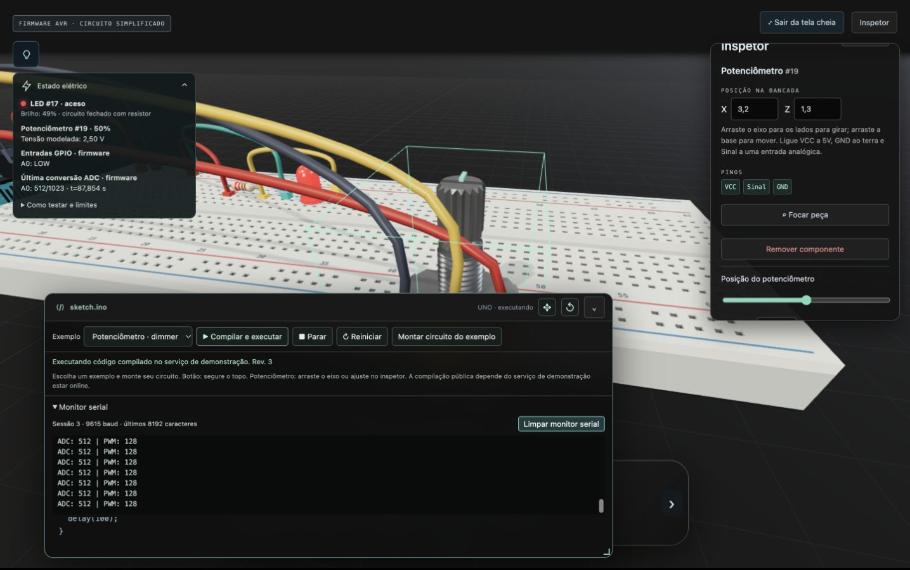

# Revisão e verificação — entradas, serial, servo e compilação pública

**[LINK TESTE — PR #30](https://rlrafael01.github.io/ghostlab/pr-30/)** · [Pull Request](https://github.com/RLrafael01/ghostlab/pull/30)

Base da revisão: main `3137cad`. Implementação e correções revisadas até `63f83fc`, branch `codex/inputs-serial-servo`. Revisão e verificações operacionais concluídas; a entrega aguarda aprovação/merge. Não houve merge automático.

## Resultado por frente

| Issue | Resultado verificado | Estado desta entrega |
| --- | --- | --- |
| #12 — Botão | Pares 1–3/2–4, INPUT_PULLUP, leitura do pino conectado, pressão/soltura por mouse e teclado, LED e sinal no painel. | Concluída na branch, aguardando merge. |
| #13 — Serial | UART real, contador/estado, monitor recolhível, limpeza sem reset, sessões e descarte limitado com unidades explícitas. | Concluída na branch, aguardando merge. |
| #14 — Potenciômetro | Gesto e controles do inspetor, ADC real, PWM, extremos/intermediário, alimentação/sinal e última conversão no painel. | Concluída na branch, aguardando merge. |
| #15 — Compilação pública | Serviço próprio isolado, HTTPS temporário configurável, código alterado executado, erro de C++ e indisponibilidade recuperáveis. | Concluída na branch, aguardando merge. |
| #16 — Servo | Servo 1.3.0, pulsos medidos por ciclos, três posições, alimentação/sinal, pose inativa e conflito real de Timer1 documentado/testado. | Concluída na branch, aguardando merge. |

Os oito demos montam circuitos editáveis com firmware real. Os quatro exemplos anteriores preservam fonte e HEX. Isso não entrega sensor, cancela, projetos persistidos ou toda a V1: #17–#24 continuam no [plano](../.scratch/v1-completion/README.md), e #8 permanece parcial.

## Testes automatizados

Execução final informada pelo responsável em 05/11/2026:

- `npm test`: **98 passaram; 3 ignorados**. Os três testes exigem execução explícita do isolamento macOS, separada da suíte portável.
- `npm run test:firmware`: **18/18 passaram**, com compilador real, worker e artefatos dos exemplos.
- Rechecagem das correções encontradas na revisão: **7 testes de interface e 2 de ADC real passaram**.
- Execução explícita do sandbox macOS: **3/3 passaram**. Bloqueio de leitura de arquivos privados, C++/Servo real, erro/timeout/recuperação HTTP, escrita no job, rede negada e limite de arquivo verificados. São testes adicionais aos ignorados na suíte portável.

**119 testes aprovados**: 98 da aplicação + 18 de firmware + 3 de isolamento. [CI da implementação `63f83fc`](https://github.com/RLrafael01/ghostlab/actions/runs/42124841210) concluída com sucesso. Build com base `/ghostlab/main/` também validado para assets, configuração e firmware; a publicação da main depende do merge aprovado e não foi alterada nesta entrega.

Fronteiras exercitadas: compilação, simulação, circuito e fluxo DOM do usuário. `peripherals-runtime.test.js` verifica GPIO/INPUT_PULLUP, ADC, UART, pulsos e Timer1; `demo-circuits.test.js` executa os HEX dos demos após conferir SHA-256, incluindo desconexão. `session-peripherals.test.js` usa worker real para entradas ao vivo e sessões. Os testes de controles/visuais usam os modelos de componentes e gestos de ponteiro/teclado. Limites HTTP, configuração e falhas do serviço têm testes próprios.

As conversões ADC são observadas ao concluir no emulador, sem calcular a leitura pela posição do potenciômetro nem exigir `Serial.print`. Os testes começaram com ausência de `analogReadings`, passaram após implementação e cobrem 0/512/1023, mudança para A1, instantes independentes, cópia segura, nova CPU e ADC desabilitado sem sobrescrever o canal anterior.

## Navegador

Captura da prévia `63f83fc`, com firmware compilado pelo serviço de demonstração. O editor foi reposicionado pelo cabeçalho em tela cheia; estado elétrico, controles e saída serial permanecem acessíveis.

Observado pelo responsável em janela normal e tela cheia:

- Potenciômetro por gesto e controles em 0%, 50% e 100%; ADC e mensagens UART correspondentes, com PWM 0/128/255 e brilho do LED.
- Botão por mouse e teclado, estados solto/pressionado e resposta de LED/serial.
- Compilação pelo HTTPS de código Blink alterado para 125 ms, executando firmware novo e mensagens UART reais.
- Servo público ativo nas posições 0°, 90° e 180°.
- C++ inválido mostra diagnóstico e preserva o texto.
- Serviço público desligado: nova compilação informa indisponibilidade e preserva o código; nenhum firmware antigo assume silenciosamente a execução. Religar no mesmo endpoint e compilar novamente recuperou o servo real.
- Mover o servo de X=3,2 para X=4 manteve atuação e fios acompanhando. Remover o fio D6 tornou o servo inativo, preservando a última pose.

A prévia do PR foi exercitada pelo navegador público com compilação HTTPS. O build da futura main respeita sua base; a URL da main só receberá esta versão após o merge e o deploy. O endpoint temporário depende do computador e do túnel ativos, sem promessa de disponibilidade permanente. A captura acima complementa os testes e o roteiro observado.

## Revisão independente

Dois revisores avaliaram Standards e Spec desde `3137cad`.

**Standards:** nenhuma violação obrigatória. Uma sugestão P3 identificou preparação geométrica semelhante nos pivôs de potenciômetro e servo. A duplicação pequena foi aceita nesta entrega; não exige alterar as interfaces dos componentes.

**Spec:** um P2 reproduziu Reiniciar após remontar um exemplo usando o identificador do Uno removido. Corrigido em `63f83fc`: o reinício resolve o alvo atual, com regressão DOM. Outra lacuna da #14 exigia mostrar leitura efetiva no painel; implementadas observação de conversões ADC e apresentação de canal/valor/instante, preservando a distinção da tensão modelada. Rechecagens passaram; nenhum bloqueador permanece nessas frentes.

## Roteiro para Enzo

1. Abra o **LINK TESTE** acima. Escolha **Botão · entrada digital**, clique duas vezes em **Montar circuito do exemplo** para confirmar a substituição e execute. Segure/solte o topo e o controle do inspetor; use Espaço/Enter. Confira LED, sinal e serial; retire/reconecte D2.
2. Monte **Potenciômetro · dimmer**. Ajuste 0%, 50% e 100% na haste, no slider e no número. Confira a última conversão ADC no painel e PWM no monitor; repetir em tela cheia. Altere a escala no sketch, compile e compare.
3. Execute **Serial · contador e LED**. Recolha/reabra, limpe o monitor e reinicie. O contador continua ao limpar; reiniciar começa outra sessão. Remonte o mesmo circuito e use Reiniciar para verificar o novo Uno.
4. Monte **Servo · 0°, 90° e 180°**, execute e observe o eixo. Edite ângulos/pausa e recompile; retire/reconecte alimentação e sinal. O servo sem entrada válida fica inativo, conservando a pose.
5. Edite Blink para 125 ms e compile pelo link. Introduza C++ inválido e confirme diagnóstico com texto preservado. A demonstração de serviço indisponível deve apresentar erro recuperável, sem trocar silenciosamente pelo firmware antigo; restaurar o serviço permite nova compilação.

Operação e restrições: [compilador público](PUBLIC-COMPILER.md), [componentes e temporização](PERIPHERALS.md). Registro das aplicações 083–088: [SKILL-USAGE](SKILL-USAGE.md).
