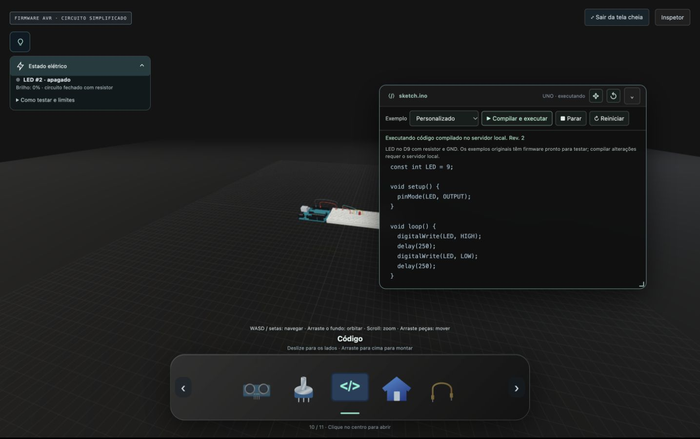

# Revisão dos painéis da bancada

Pedido: separar dica e estado elétrico, recolher o card por clique, mover/redimensionar o editor em fullscreen e identificar código alterado como Personalizado.

Base: `6a1f31af07a59727d9db944846f5c3733b0eea61`. Implementação: `30fe489`.

## Standards

0 achados. Revisados captura/cancelamento de ponteiros, isolamento dos controles, limites, restauração do layout normal, preservação do texto e documentação. Nenhuma violação dos padrões documentados ou problema material pelos critérios de smells.

## Spec

0 achados. Os três pedidos estão contemplados; saída do fullscreen restaura o editor inline. Revisados limites, cancelamento/propriedade do ponteiro, controles independentes e reconhecimento do código original. Sem requisito parcial ou expansão indevida do escopo.

## Verificação

- `npm test`: 64 testes passaram; `npm run build`: aprovado. Aviso existente de tamanho do bundle mantido.
- Ciclos red/green em interações DOM: card recolhível, alteração do preset, arraste/resize, teclado e cancelamento.
- Navegador em 1440×900 e 1024×768: ajuda e estado elétrico separados, card aberto/recolhido e limites com rolagem; editor normal e fullscreen.
- Arraste real do cabeçalho e canto inferior direito: 900×420 → 550×420 e deslocamento para a direita. Fechar/reabrir preserva geometria e texto. Setas/Shift e Restaurar janela verificados.
- Blink editado de 1000 para 250 ms muda para Personalizado; código original restaura Blink. Programa modificado compilado e executado no servidor local. Sair do fullscreen restaura estilos inline e mantém código/execução.
- A prévia pública mantém o contrato atual: executar exemplos originais; compilação de código modificado requer servidor local.

